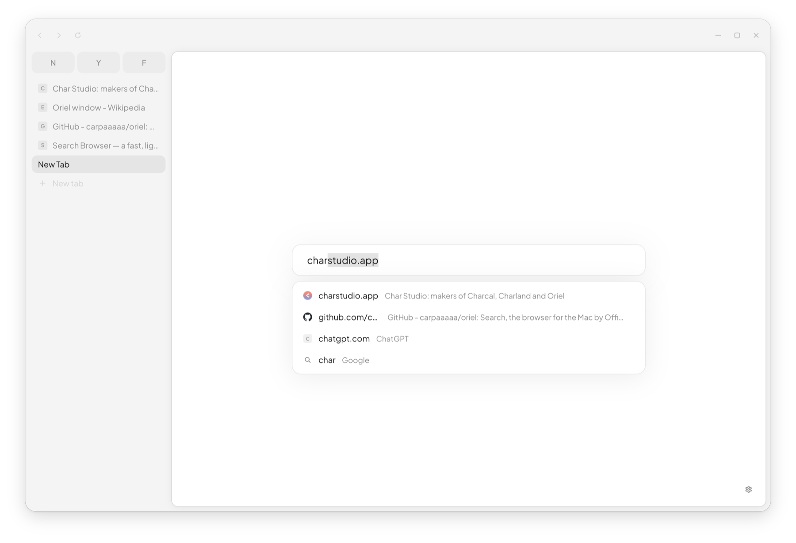
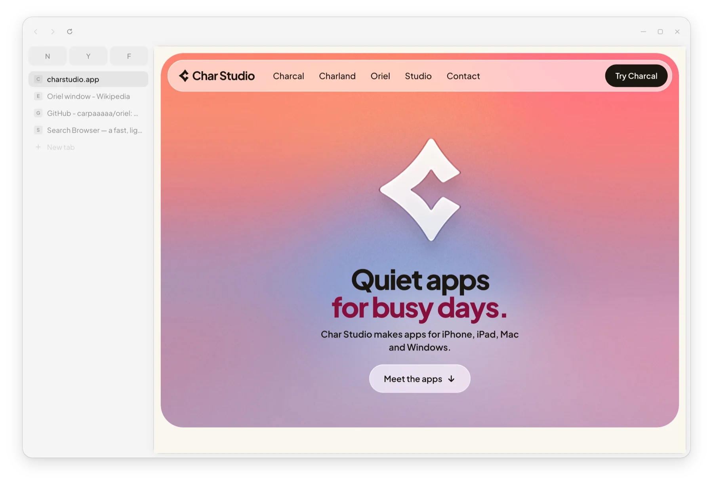

# Oriel

A free, open source web browser for Windows. An unofficial port of [Search](https://github.com/driceroland/Search), the browser for the Mac by Office Commun, made by [Char Studio](https://charstudio.app).



**[Download for Windows](https://oriel.charstudio.app/download)** · Windows 10 or 11 · x64 or ARM64 · free · [website](https://oriel.charstudio.app) · [releases](https://github.com/carpaaaaa/oriel/releases)

---

## What it is

Oriel is Search's design, on Windows. A column of tabs down the left (or a strip across the top, if you prefer), one field for addresses and searches, and the page as a card beside them. No toolbar, no start page full of suggestions, no account to sign into.

Search runs on WebKit, the engine built into macOS. Windows has no such engine to borrow, so Oriel is built on Chromium through Electron: pages look as they do in Chrome, Chrome extensions work, and the installer is about 120 MB rather than Search's ten. Everything else was measured from Search's own source: the column, the field, the spaces and pins, the shortcuts (Ctrl where the Mac has Cmd), the settings, the springs.

Oriel is not affiliated with or endorsed by Office Commun. Search is their name and their work, and it stays on the Mac; Oriel is a separate port under the same MIT license.

## What it does

- **One field.** Type an address and you go there, type words and you search. It finishes addresses from your history and your open tabs. Suggestions from your search engine are off until you turn them on.
- **Tabs down the side, or across the top.** The grey follows the tab you pick. Pin the sites you keep open all day and they become a letter, or their icon, at the top of the column; Ctrl+W puts a pin to sleep instead of closing it.
- **Spaces.** Separate sets of tabs for work, home or a side project. Alt+1 to Alt+9 goes straight to one; two fingers sideways over the tabs slides to the next.
- **Chrome extensions.** Installed straight from the Chrome Web Store, with their popups, side panels and keyboard shortcuts. Their buttons appear once you have one installed.
- **Bring everything over.** Bookmarks, history, extensions and passwords from Chrome, Edge, Brave, Opera, Opera GX, Vivaldi, Arc, Firefox and Zen. Passwords come straight over where Windows' own encryption guards them, once you say yes; Chrome, Edge and Brave now lock theirs to themselves, so for those Oriel reads the file they export. It never tries to get around that lock. Nothing in the other browser changes.
- **Ads and trackers blocked** in the network layer, before they load. Click trackers come off links, pages go to HTTPS first, and Global Privacy Control is sent.
- **Passwords behind Windows Hello.** Kept in Oriel's own vault, encrypted under a key Windows seals to your account, and shown or filled after Windows Hello or your Windows password. Passkeys go through Windows Hello too.
- **Reading mode** (Ctrl+Shift+R), **floating video** that follows you above every app, **peek** at a link with a Shift-click, **split view**, a **Ctrl+Tab switcher** with a card for each recent tab, **private tabs** (Ctrl+Shift+N), and **site styles**: your own CSS for a site.
- **Translate a page on your PC**, with Firefox's open translation models. The model for a pair of languages is downloaded once; the text never leaves your computer.
- **Tabs that sleep** when you leave them a while, and wake where you were: scroll position and typed text included.
- **Sync through a folder** you choose, in OneDrive, Dropbox, iCloud for Windows or on a shared disk: spaces, pins, bookmarks and a few settings. The files are Search's own, so Oriel on a PC and Search on a Mac keep each other up to date. Never history, passwords, cookies or tabs that aren't pinned.
- **Updates itself.** It looks for a new release at launch and every hour, downloads it quietly and puts it in place the next time you open Oriel. Settings › About shows where it is.



## What it doesn't do

On purpose, or not yet:

- **No account, no server, no telemetry.** Oriel doesn't count you or send how you use it. It talks to GitHub to update itself and to the Chrome Web Store for extensions; everything else is the pages you open. Details: [Privacy](https://oriel.charstudio.app/privacy).
- **Sign-ins don't come over** from other browsers: each site asks once, and your passwords are there to fill it.
- **Not the Mac's glass.** Windows has Mica and Acrylic, which are close but not the same, and Oriel won't fake it.
- **Not code-signed yet**, so Windows warns on the first install (below). What is being built and planned: [Roadmap](https://oriel.charstudio.app/roadmap).

## Install

| File | For |
|---|---|
| [Installer, x64](https://oriel.charstudio.app/download) | most PCs (Intel or AMD) |
| [Installer, ARM64](https://oriel.charstudio.app/download/arm64) | PCs with a Snapdragon processor |
| [Portable, x64](https://oriel.charstudio.app/download/portable) | runs without installing; never updates itself |

The links always point to the latest release; every file is also on the [releases page](https://github.com/carpaaaaa/oriel/releases), built by GitHub Actions from this repository.

### From a terminal

| With | Run |
|---|---|
| [Scoop](https://scoop.sh/) | `scoop bucket add oriel https://github.com/carpaaaaa/scoop-oriel`, then `scoop install oriel` |
| [winget](https://learn.microsoft.com/windows/package-manager/) | `winget install CharStudio.Oriel`: the package is waiting for Microsoft's moderators |
| [Chocolatey](https://chocolatey.org/) | `choco install oriel`: sent to chocolatey.org, in moderation (the package is in `packaging/chocolatey`) |

Each one runs the same installer as the download button, silently, for you alone, and checks its SHA-256. This page changes when winget and Chocolatey are in.

### Check a download

Every release has a `SHA256SUMS.txt` with the SHA-256 of each installer. In PowerShell: `Get-FileHash .\Oriel-Setup-0.1.11-x64.exe`, and compare it with the line for that file.

Open the installer and that's all: Oriel installs for you alone (no administrator needed, no questions) and opens when it's done. Because the installer isn't signed yet, Windows SmartScreen says "Windows protected your PC" the first time: choose **More info**, then **Run anyway**. To make Oriel your default browser: Settings, Make it the default, which opens Windows' Default apps on Oriel.

## Security

What to know before installing, said plainly:

- **The installers and updates aren't code-signed.** Oriel has no code-signing certificate yet. Windows shows "Windows protected your PC" on the first install (More info, then Run anyway), and the updater checks only that a downloaded installer matches the SHA-512 written next to it in the release (`latest.yml`), on the same GitHub page. Nothing checks who made it: anyone who took over this repository or its release token could ship an update that installed copies would accept, and with "Install updates on its own" on it would be put in place when Oriel quits. Signing (and setting the publisher so the updater checks the signature) is the fix, and it needs a certificate. Until then, with "Install updates on its own" off (Settings › About) nothing is installed until you press Install, so you can look at the release on GitHub first.
- **The portable copy never updates itself**: download the new version to update it.
- **Checking for updates sends nothing about you**: Oriel asks GitHub for the latest release at launch and every hour. There is no telemetry.
- **Passwords** are encrypted on disk with a key that Windows keeps for your user account (DPAPI). Windows Hello guards showing and copying them in Oriel, not the file: another program running as you can read it, as with other browsers.
- **Test hooks** (`SEARCH_PROBE` and the other variables the tests use) work only in a build run from source with `electron .`; an installed copy ignores them.

Found a security problem? Please report it privately, as [SECURITY.md](SECURITY.md) explains, not on Search's repository: Office Commun has nothing to do with Oriel's code.

## Build from source

Node 24 or later.

```
npm ci
npm run build
npm start
```

Installers for Windows (x64 and ARM64): `npm run dist`, run on Windows.

Tests drive the app through a socket, in a world of its own that never touches your settings (`test/bench.py`):

```
python3 test/f0_core.py
```

Every push runs the tests on real Windows machines through GitHub Actions, on x64 and ARM.

## Repository

- `src/main` the main process: windows, tabs, spaces, extensions, import, passwords, network, updates.
- `src/ui` the interface, in Solid and TypeScript; `src/shared` the contracts between them.
- `test` the tests; `release-notes` the notes of each version.
- `studio/` and `PIANO.md` (in Italian) hold the study of Search's Mac source, the decisions and the plan.

## Help and feedback

Questions: [FAQ](https://oriel.charstudio.app/faq). A bug or an idea: [open an issue](https://github.com/carpaaaaa/oriel/issues/new/choose), or write to support@charstudio.app. Please don't send Oriel's problems to Office Commun: they make Search, not Oriel.

## Credits

Oriel is built on [Search](https://github.com/driceroland/Search) by Office Commun, and on Electron, electron-chrome-extensions, Solid, koffi, tldts and the Plus Jakarta Sans typeface, among others. Who made what, and under which license: [CREDITS.md](CREDITS.md). Every package inside the app, with its license text: [THIRD_PARTY_LICENSES.md](THIRD_PARTY_LICENSES.md).

## License

MIT, like Search. See [LICENSE](LICENSE), which keeps Office Commun's copyright notice. Windows is a trademark of the Microsoft group of companies.
